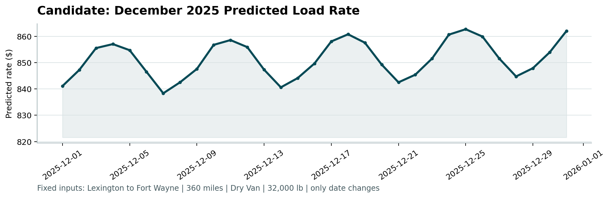

# Freight Rate Prediction: Validation Approach and December Chart

All numbers below come from `run_pipeline.py` (saved in `outputs/`) and are reproduced in
`notebooks/freight_rate_model.ipynb`. Errors are reported as MAPE: the average absolute error as a percentage of the
true rate.

---

## 1. Approach to validating and splitting the train/test data

### 1.1 What the validation had to reflect

Before choosing a split, I checked how the loads to predict (`validation.csv`) differ from the labelled data
(`train_test.csv`). Three differences shaped the whole validation design:

| Difference | Evidence | Consequence for validation |
|---|---|---|
| **The prediction period is in the future** | Labels cover 2025-01-01 to 2025-10-31; all 12,000 loads to predict are dated 2025-11-01 to 2025-12-31 | The split must be **time-based**: always train on earlier dates and test on later ones |
| **Rates drift over time** | Holding market index, weight, distance and equipment fixed, rates rise about 0.6% per month (fitted trend +0.63% per month) | A random split would hide trend-extrapolation errors, because every test day would sit between training days |
| **New cities appear** | 8 cities (Allentown, Charlotte, Chicago, Jackson, Knoxville, Laredo, Norfolk, San Diego) never appear in training; 1,447 loads to predict (12%) touch one | A separate test where whole cities are hidden from training is needed |

A fourth finding showed why a random split would be actively misleading. `quote_signal` follows the true rate per mile
almost exactly in some months (correlation +0.98), is an inverted copy of it in others (−0.97), and is pure noise in
August. I built a label-free daily check: for each day, correlate the quotes with a quote-free model's expected rate.
It shows **every day in November and December is in the noise regime**. In the months where the quote tracks the
rate, the quote alone is within 0.7% (median) of the true rate per mile, so a model using it would look excellent
when tested on January to October. That accuracy would not carry over to the actual predictions. The final model
therefore does not use `quote_signal`.

| Months | `quote_signal` behaviour | Mean daily correlation |
|---|---|---|
| Jan, Feb, Mar, Jun, Sep | tracks the true rate | +0.98 |
| Apr, May, Jul, Oct | inverted copy of the rate | −0.97 |
| Aug, **Nov, Dec (prediction period)** | noise | about 0.00 |

### 1.2 Data used for training and testing

- **Label errors removed from training:** 677 rows (1.4%) have a rate more than 2 times above or below the normal
  rate per mile for their equipment and distance band. Their median ratios are 3.4 times too high and 0.28 times
  (about a quarter) too low. They are excluded when fitting every model.
- **Test metrics** are reported on clean test labels, and on all test labels for the main holdout. The flagged rows
  can't be predicted by any model, and they dominate RMSE.
- **Input fixes (no labels involved):** negative weights (292) are treated as sign errors. Missing weights (300) are
  filled with the median weight for that equipment type, learned from training rows. Missing `market_index` values (374)
  are filled with that day's average `market_index` across all posted loads.

### 1.3 The three validation splits

**Split A: time-based holdout (main test).** Train on January to August, test on September to October (9,523 loads).
This mirrors the real task of predicting the next two months.

| Model | MAE ($) | RMSE ($) | MAPE | R² | MAPE, all labels |
|---|---|---|---|---|---|
| Baseline: lane average | 82.16 | 120.10 | 3.45% | 0.992 | 5.96% |
| Ridge regression | 62.67 | 87.91 | 2.68% | 0.996 | 5.15% |
| **LightGBM + linear trend** | **47.80** | **73.12** | **1.98%** | **0.997** | **4.48%** |

Error breakdown for the final model on this holdout:

| Segment | Loads | MAE ($) | MAPE |
|---|---|---|---|
| Dry Van | 5,275 | 37.82 | 1.67% |
| Flatbed | 1,746 | 69.25 | 2.78% |
| Reefer | 2,358 | 54.21 | 2.10% |
| Under 300 miles | 770 | 11.63 | 2.07% |
| 300–800 miles | 3,075 | 24.96 | 1.94% |
| 800–1,500 miles | 2,872 | 47.01 | 2.00% |
| Over 1,500 miles | 2,662 | 85.49 | 1.99% |

**Split B: new-city holdout.** Same time split, but 8 randomly chosen cities (Bakersfield, Hartford, Memphis,
New York, San Antonio, Toledo, Tulsa, Washington) are removed from training entirely. This mirrors the 12% of
prediction loads that touch a city with no history.

| Model | MAPE, loads touching a new city | MAPE, loads between known cities |
|---|---|---|
| Baseline: lane average | 3.79% | 3.48% |
| Ridge regression | 2.82% | 2.68% |
| **LightGBM + linear trend** | **2.22%** | **2.01%** |

New cities cost only about 0.2 percentage points. This is because cities are represented by coordinates and by city
effects borrowed from the three nearest known cities, rather than as category labels the model has never seen.

**Split C: rolling monthly validation (expanding window).** For each month from June to October, train on all earlier
months and test on that month. This checks that the result is stable over time, not a lucky single split.

| Test month | Training rows | Baseline | Ridge | **LightGBM + trend** |
|---|---|---|---|---|
| 2025-06 | 24,023 | 6.13% | **2.02%** | 2.11% |
| 2025-07 | 28,806 | 4.07% | 4.85% | **3.21%** |
| 2025-08 | 33,718 | 3.53% | **1.44%** | 1.74% |
| 2025-09 | 38,477 | 3.48% | 3.05% | **2.42%** |
| 2025-10 | 43,147 | 3.34% | 1.67% | **1.37%** |
| **Mean** | | 4.11% | 2.60% | **2.17%** |

Ridge wins two months (June and August) but swings much more, from 1.44% to 4.85%. LightGBM has the lowest average
and the smallest worst-case error. July is the hardest month for Ridge and LightGBM (June is hardest for the baseline).
With only January to June to learn from, the fitted trend is +1.36% per month, so July predictions come out about
3.1% too high on average. With the full ten months the trend settles at +0.63% per month.

### 1.4 Leakage controls

- **No random splits anywhere.** Every test set is strictly later in time than its training set.
- **Out-of-fold lane and city effects.** Average rates for each lane, pickup city and delivery city are computed with
  5-fold out-of-fold encoding on training rows, so a row never sees its own label.
- **Day-level features kept out of the trees.** Values shared by every load on a day (daily market average, rolling
  averages, day of month) act like a date ID and let trees memorise training days. They are not given to LightGBM.
- **No holiday features.** A "days to nearest holiday" feature behaved the same way. Christmas never appears in the
  training data, so it was removed: rolling error improved from 2.23% to 2.17%, with holdout and new-city error essentially unchanged.
- **Trend handled by a linear first stage.** Trees can't extrapolate past the last training date, so a linear model on
  time, market index, weight, distance and equipment captures the trend. LightGBM then models what is left.
- **Only input features are shared with the prediction period.** Daily market averages and the quote-regime check use
  features of the prediction loads, never labels.

### 1.5 Model choice and final training

LightGBM with a linear trend had the lowest error of the three models on the September–October holdout, on loads
touching unseen cities, and on average across the rolling months, with the most stable month-to-month error. The final
model is retrained on **all clean labelled data (January to October 2025, 47,323 rows)** and used to predict the 12,000
loads in `validation_predictions.csv` (median predicted rate \$2,064.56, range \$196.06 to \$6,945.57).

---

## 2. Fixed December prediction chart (produced by `score.py`)

```bash
python score.py --predictions validation_predictions.csv --december-predictions data/december_chart_inputs.csv
```

```text
Validated 12,000 final predictions.
Validated 31 fixed December predictions.
Created chart: scorer_results\candidate_december.png
Final validation metrics are calculated by Spotter after submission.
```



**Fixed inputs:** Lexington to Fort Wayne, 360 miles, Dry Van, 32,000 lb. Only the date changes.

**Inputs the chart file doesn't provide:**

- **City coordinates** come from the training data.
- **`market_index`** for each December day is the average over that day's loads in `validation.csv` (163 to 227 loads
  per day, 6,164 December loads in total). It ranges from 0.83 to 1.04 across the month.

**What the chart shows:**

- Predicted rates stay in a narrow band, **\$838.34 to \$862.68** (mean about \$851, about \$2.36 per mile).
- The day-to-day wave follows the daily market index (correlation 0.98 between predicted rate and daily market index).
  Holding the market index fixed, predictions drift up about 0.5% over the month, in line with the fitted time trend.
- **Sanity check against history:** 21 Dry Van loads on this lane between January and October had a median rate of
  \$807.89. The three October loads were \$796.48–\$864.61, at lighter weights (17,917–26,829 lb). A 32,000 lb load in December, after two
  more months of upward trend, sitting at \$838–\$863 is consistent with that history.
